# Teams APIs Extension - Architecture Documentation

## Overview

| Property | Value |
|----------|-------|
| **Extension Name** | Teams APIs |
| **Version** | 2.0.8 |
| **JAX-RS ID** | teams-apis |
| **Domain** | Collaboration |
| **Ecosystem** | Essentials |
| **Java Version** | Java 21 |
| **Primary API** | Microsoft Graph API |
| **Authentication** | OAuth 2.0 with MSAL4J |

---

## Architecture Diagram

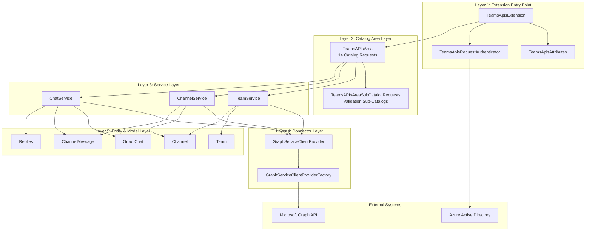

---

## Layer Details

### Layer 1: Extension Entry Point

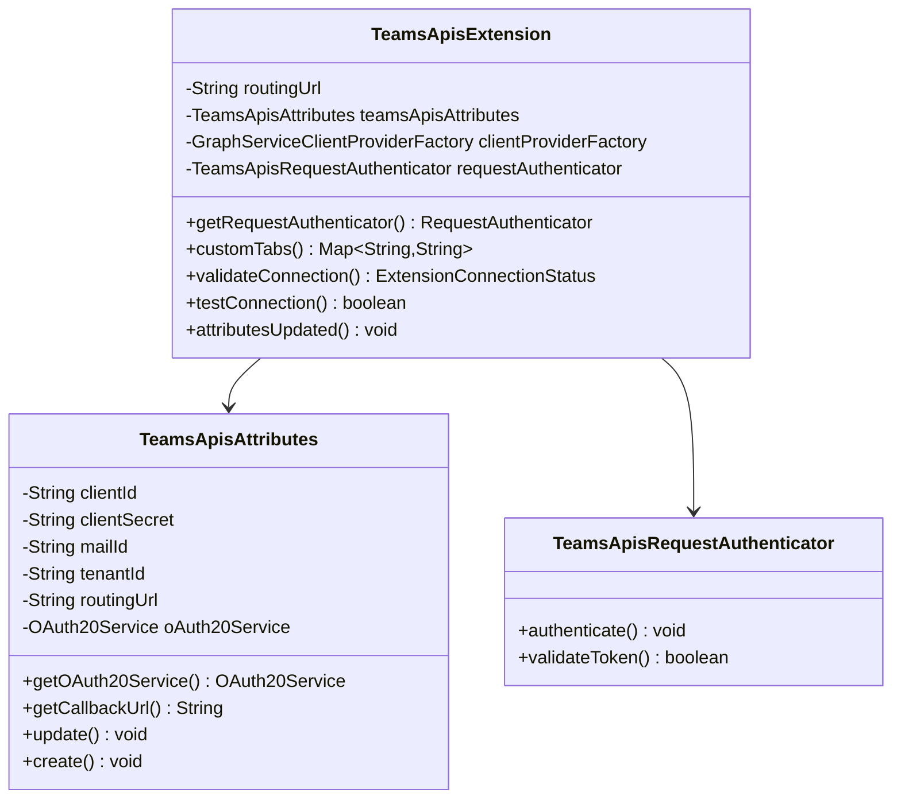

**Responsibilities:**
- Configuration management (clientId, clientSecret, tenantId, email)
- OAuth 2.0 authentication flow
- Connection validation with Microsoft Graph API
- Request authentication via `TeamsApisRequestAuthenticator`

---

### Layer 2: Catalog Area Layer

```mermaid
flowchart LR
    subgraph CatalogRequests["14 Catalog Requests"]
        CR1[Get channels of team]
        CR2[Send message teams group]
        CR3[Send HTML message teams group]
        CR4[Send message to teams channel]
        CR5[Get Channel Messages]
        CR6[Get Group Chat Messages]
        CR7[Get Group Chat by Name]
        CR8[Get All Teams]
        CR9[Get All Group Chats]
        CR10[Get Channel Message Replies]
        CR11[Get Channels of Team by ID]
        CR12[Send Message to User]
        CR13[Send HTML Message to User]
        CR14[Send HTML message to channel]
    end

    subgraph SubCatalogs["Validation Sub-Catalogs"]
        SC1[confirmReenterGetChannelMessages]
        SC2[handleReenterGetChannelMessages]
        SC3[confirmDateValidation...]
        SC4[handleDateValidation...]
        SC5[confirmGroupNameValidation...]
        SC6[handleGroupNameValidation...]
    end

    CatalogRequests --> SubCatalogs
```

**Responsibilities:**
- Handle all 14 catalog requests
- Telemetry tracking (success/failure counters)
- Validation orchestration
- Error handling with sub-catalog re-entry flows

---

### Layer 3: Service Layer

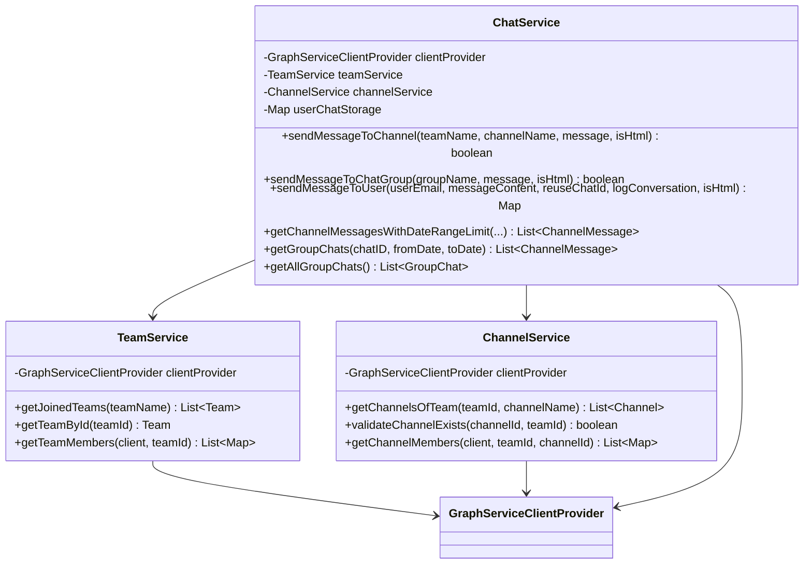

**Responsibilities:**
- Business logic implementation
- Microsoft Graph API operations
- Pagination handling
- Chat ID caching for performance

---

### Layer 4: Connector Layer

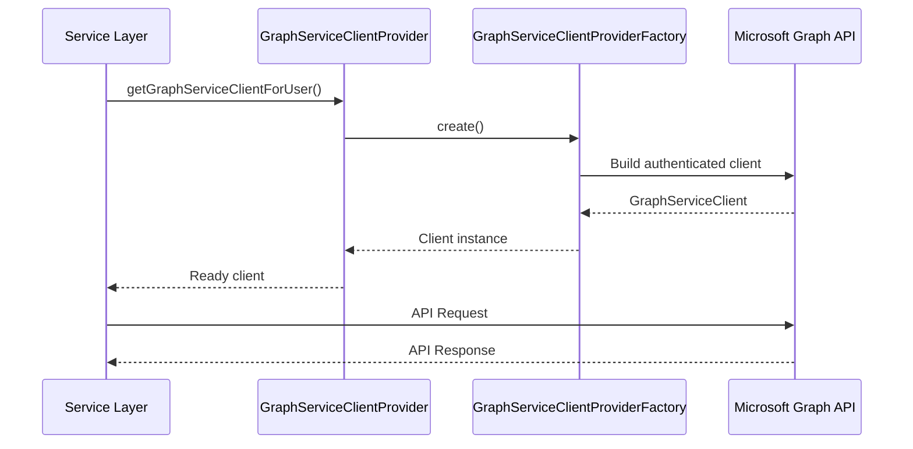

**Responsibilities:**
- Create and manage `GraphServiceClient` instances
- Handle OAuth token management
- Provide authenticated clients to services

---

### Layer 5: Entity & Model Layer

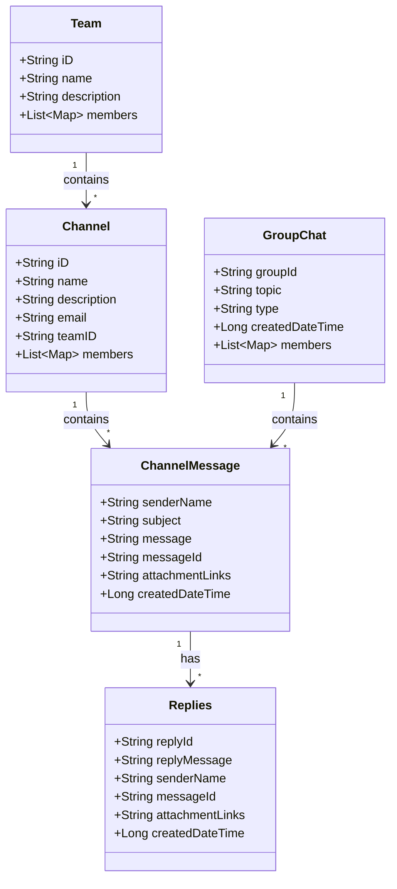

---

## Data Flow Diagrams

### Send Message to Channel Flow

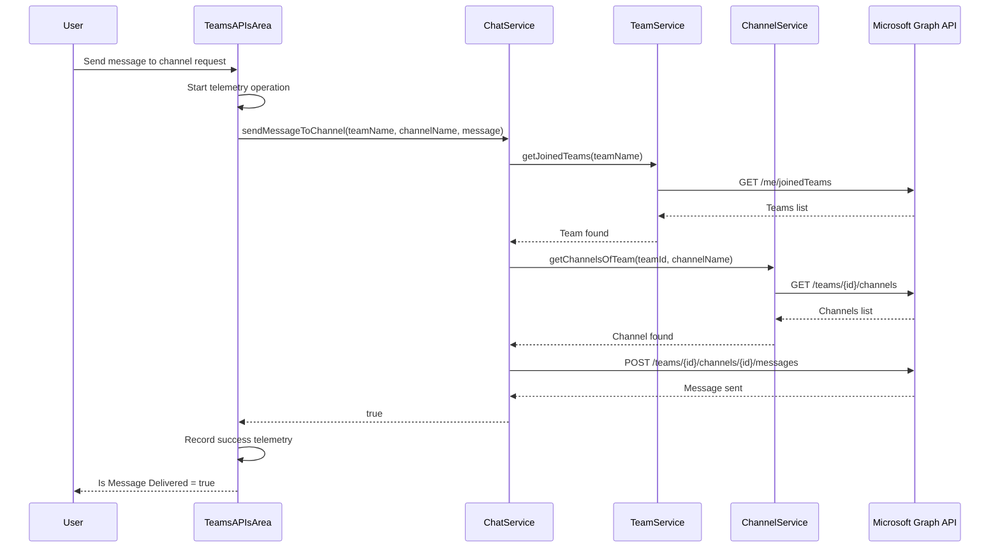

### Get Channel Messages with Date Filter Flow

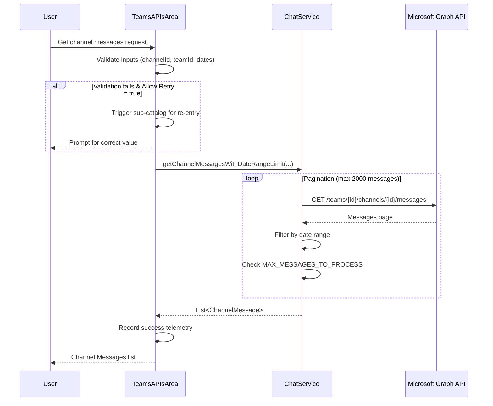

---

## Performance Characteristics

### Pagination Configuration

| Parameter | Value | Description |
|-----------|-------|-------------|
| `MAX_MESSAGES_TO_PROCESS` | 2000 | Maximum messages retrieved per request |
| `MAX_SKIP_COUNT` | 1000 | Maximum pagination skip count |
| `DEFAULT_PAGE_SIZE` | 50 | Default page size for API calls |

### Performance Limitations

| Limitation | Value | Impact |
|------------|-------|--------|
| Message Size Limit | 28,000 characters | Large HTML messages will fail |
| Max Messages per Request | 2000 | Older messages may be truncated |
| API Rate Limits | Microsoft Graph limits | May cause throttling |
| Chat ID Cache | In-memory only | Lost on extension restart |

### Performance Best Practices

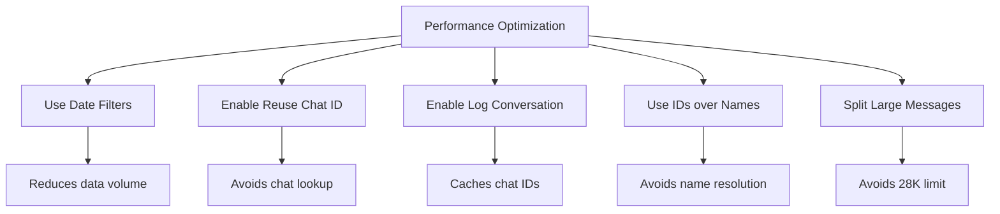

---

## Error Scenarios

### Error Handling Flow

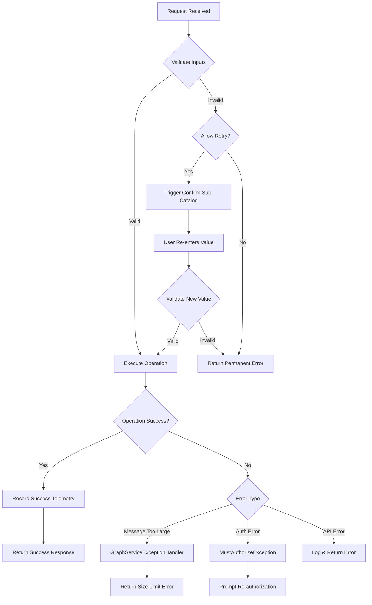

### Error Categories

| Error Type | Cause | Detection | Solution |
|------------|-------|-----------|----------|
| **Authentication Error** | Invalid/expired OAuth token | `MustAuthorizeException` | Re-authorize extension |
| **Team Not Found** | Team name incorrect or no access | Empty team list | Verify team name |
| **Channel Not Found** | Channel doesn't exist in team | Empty channel list | Verify channel name |
| **Group Chat Not Found** | No group with specified name | Empty chat list | Verify group topic |
| **Multiple Groups Found** | Duplicate group names | `allChats.size() > 1` | Use unique names or Chat ID |
| **Message Too Large** | Exceeds 28,000 characters | HTTP 400 + InvalidParameter | Split message |
| **Invalid Date Range** | From date > To date | Validation check | Correct dates |
| **User Not Found** | Email doesn't exist in tenant | Graph API error | Verify email |
| **Permission Denied** | Missing Graph API permissions | 403 response | Grant permissions |
| **Rate Limited** | Too many API requests | 429 response | Implement backoff |

### Message Size Error Handling

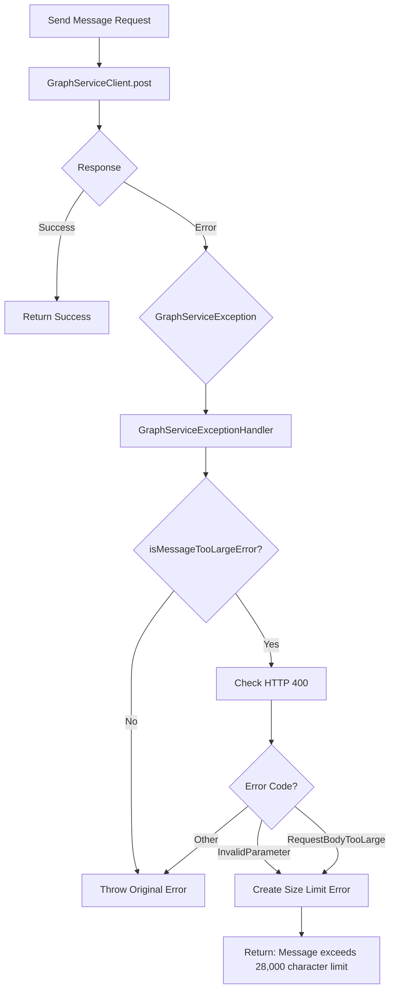

---

## Validation Framework

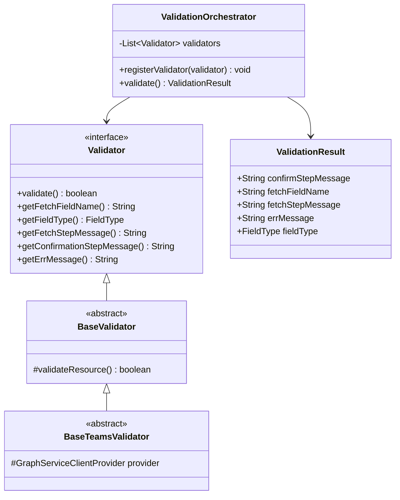

### Validation Resources

| Resource | Description | Used By |
|----------|-------------|---------|
| `CHANNEL_ID` | Channel identifier | Get Channel Messages |
| `TEAM_ID` | Team identifier | Multiple requests |
| `CHAT_ID` | Chat identifier | Get Group Chat Messages |
| `FROM_DATE` | Start date filter | Message retrieval |
| `TO_DATE` | End date filter | Message retrieval |
| `GROUP_NAME` | Group chat topic | Get Group Chat by Name |
| `CHANNEL_TEAM_LINK` | Channel-Team association | Get Channel Messages |
| `USER_EMAIL` | User email address | Send Message to User |
| `MESSAGE_CONTENT` | Message text | Send operations |
| `HTML_MESSAGE_CONTENT` | HTML message | HTML send operations |

---

## Technology Stack

| Component | Technology | Purpose |
|-----------|------------|---------|
| **Runtime** | Java 21 | Application runtime |
| **DI Framework** | HK2 | Dependency injection |
| **Graph SDK** | Microsoft Graph SDK for Java | Teams API integration |
| **Auth Library** | MSAL4J | OAuth 2.0 authentication |
| **Logging** | SLF4J | Logging framework |
| **JSON** | Gson | JSON serialization |
| **HTTP Client** | OkHttp (via Graph SDK) | HTTP communication |
| **Extension Framework** | Krista SDK | Extension annotations and APIs |

---

## Package Structure

```
teams-apis/src/main/java/app/krista/extensions/essentials/collaboration/teams/
├── TeamsApisExtension.java              # [Layer 1] Extension entry point
├── TeamsApisAttributes.java             # [Layer 1] Configuration attributes
├── catalog/
│   ├── TeamsAPIsArea.java               # [Layer 2] Main catalog (14 requests)
│   ├── TeamsAPIsAreaSubCatalogRequests.java  # [Layer 2] Validation sub-catalogs
│   └── entities/
│       ├── Channel.java                 # [Layer 5] Channel entity
│       ├── Team.java                    # [Layer 5] Team entity
│       ├── GroupChat.java               # [Layer 5] GroupChat entity
│       ├── ChannelMessage.java          # [Layer 5] ChannelMessage entity
│       └── stores/
│           └── Replies.java             # [Layer 5] Replies entity
├── service/
│   ├── TeamService.java                 # [Layer 3] Team operations
│   ├── ChannelService.java              # [Layer 3] Channel operations
│   └── ChatService.java                 # [Layer 3] Chat and messaging
├── impl/
│   ├── connectors/
│   │   ├── GraphServiceClientProvider.java      # [Layer 4] Client provider
│   │   └── GraphServiceClientProviderFactory.java  # [Layer 4] Factory
│   └── util/
│       ├── Constants.java               # Constants
│       └── TelemetryConstants.java      # Telemetry metrics
└── errorhandling/
    ├── constants/
    │   ├── SubCatalogConstants.java     # Sub-catalog constants
    │   └── TeamsResources.java          # Resource field names
    ├── generators/
    │   └── ExtensionResponseGenerator.java  # Response generation
    ├── validators/
    │   ├── Validator.java               # Validator interface
    │   ├── BaseValidator.java           # Base validator
    │   └── ValidationOrchestrator.java  # Validation orchestration
    └── utils/
        └── GraphServiceExceptionHandler.java  # Exception handling
```

---

## Security Considerations

| Aspect | Implementation |
|--------|----------------|
| **Credential Storage** | clientSecret and tenantId marked as `isSecured = true` |
| **Token Management** | OAuth 2.0 with refresh token support |
| **API Communication** | HTTPS only via Microsoft Graph API |
| **Permission Model** | Azure AD app permissions with user consent |
| **Session Handling** | TeamsApisRequestAuthenticator validates each request |

---

## Telemetry Metrics

| Operation | Success Counter | Failure Counter |
|-----------|-----------------|-----------------|
| Get Channels of Team | `teams.get_channels_of_team.request.success` | `teams.get_channels_of_team.request.failure` |
| Send Message Teams Group | `teams.send_message_teams_group.request.success` | `teams.send_message_teams_group.request.failure` |
| Send HTML Message Teams Group | `teams.send_html_message_teams_group.request.success` | `teams.send_html_message_teams_group.request.failure` |
| Send Message to Channel | `teams.send_message_to_channel.request.success` | `teams.send_message_to_channel.request.failure` |
| Get Channel Messages | `teams.get_channel_messages.request.success` | `teams.get_channel_messages.request.failure` |
| Get Group Chat Messages | `teams.get_group_chat_messages.request.success` | `teams.get_group_chat_messages.request.failure` |
| Get Group Chat by Name | `teams.get_group_chat_by_name.request.success` | `teams.get_group_chat_by_name.request.failure` |
| Get All Teams | `teams.get_all_teams.request.success` | `teams.get_all_teams.request.failure` |
| Get All Group Chats | `teams.get_all_group_chats.request.success` | `teams.get_all_group_chats.request.failure` |
| Get Channel Message Replies | `teams.get_channel_message_replies.request.success` | `teams.get_channel_message_replies.request.failure` |
| Get Channels by Team ID | `teams.get_channels_of_team_by_id.request.success` | `teams.get_channels_of_team_by_id.request.failure` |
| Send Message to User | `teams.send_message_to_user.request.success` | `teams.send_message_to_user.request.failure` |
| Send HTML Message to User | `teams.send_html_message_to_user.request.success` | `teams.send_html_message_to_user.request.failure` |
| Send HTML Message to Channel | `teams.send_html_message_to_channel.request.success` | `teams.send_html_message_to_channel.request.failure` |

