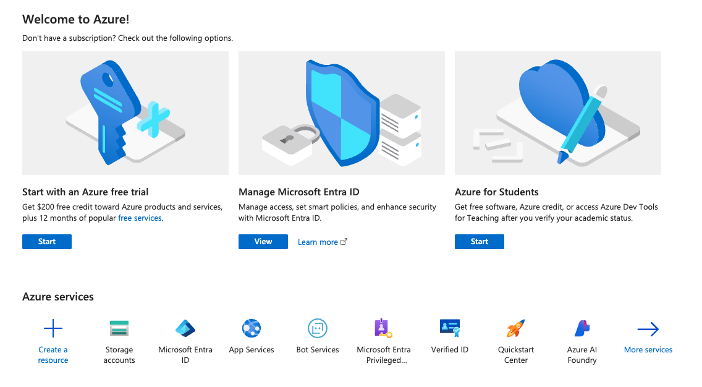
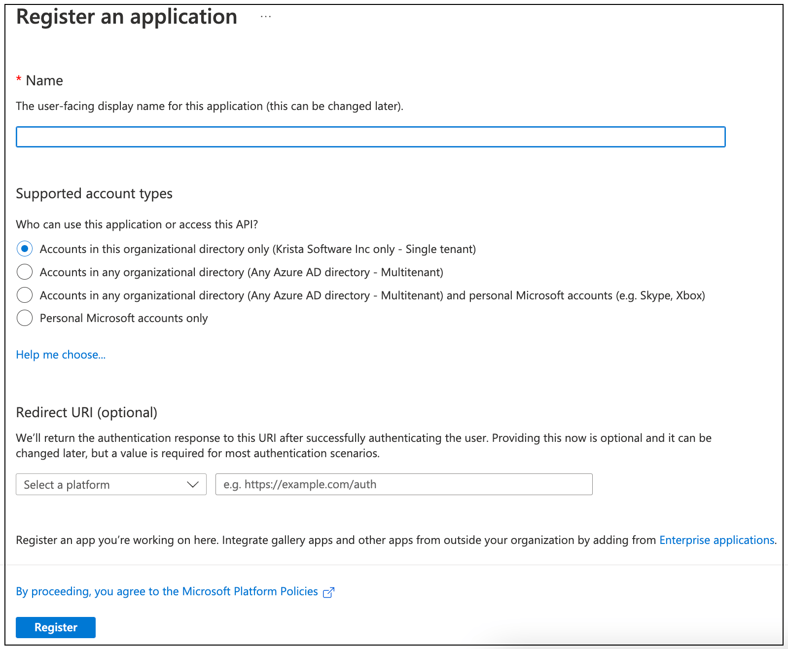
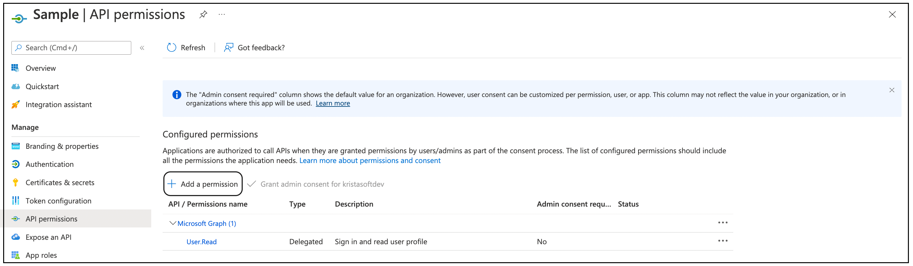
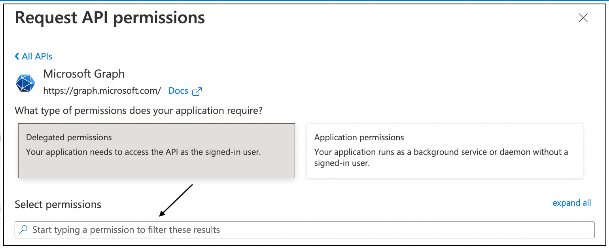
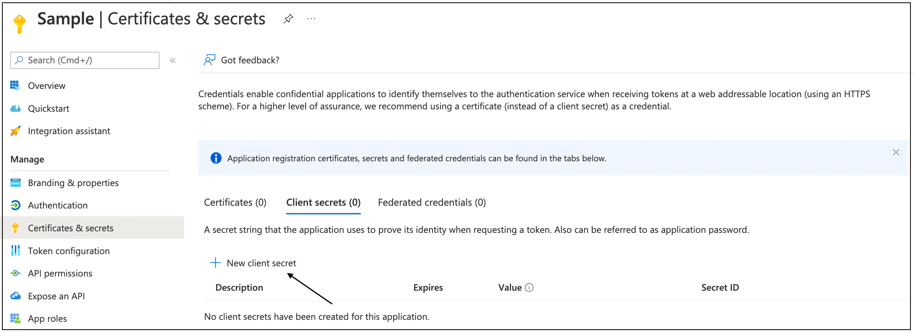

# Creating Teams App in Azure AD

## Overview

To use the Teams APIs Extension, you must create an Azure AD (Microsoft Entra ID) application that will serve as the identity for your integration. This application provides the credentials (Client ID, Client Secret, Tenant ID) needed to authenticate with Microsoft Teams through the Microsoft Graph API.

This guide provides step-by-step instructions for creating and configuring your Azure AD application.

---

## Prerequisites

Before you begin, ensure you have:

- A Microsoft 365 account with Teams access
- Azure AD (Microsoft Entra ID) admin access
- Permissions to create app registrations in Azure AD
- Permissions to grant admin consent for API permissions

> **Note**: If you don't have admin access, you'll need to work with your Azure AD administrator to complete these steps.

---

## Step-by-Step Instructions

### Step 1: Access Azure Portal

1. Navigate to the [Azure Portal](https://portal.azure.com/)
2. Sign in with your Microsoft 365 admin account



### Step 2: Navigate to Microsoft Entra ID

1. Under **Azure services**, click **Microsoft Entra ID**
2. If not visible, click **More services** to find Microsoft Entra ID


> **Note**: Microsoft Entra ID is the new name for Azure Active Directory.

### Step 3: Open App Registrations

1. On the Microsoft Entra ID Overview page
2. In the left menu under **Manage**, click **App registrations**


### Step 4: Create New Application

1. At the top of the App registrations page, click **+ New registration**


### Step 5: Register the Application

On the **Register an application** page, configure the following:

#### Application Name
- **Name**: Enter a descriptive name (e.g., "Krista Teams Integration")
- This name will be displayed to users during authentication

#### Supported Account Types
Select: **Accounts in this organizational directory only (Single tenant)**

- This is the most secure option
- Limits access to users in your organization only
- Recommended for enterprise applications

#### Redirect URI
1. Select platform: **Web**
2. Enter the redirect URI (you'll update this later with the actual Krista callback URL)
   - Temporary value: `https://localhost`
   - You'll update this after configuring the extension in Krista

3. Click **Register**



> **Important**: You must update the redirect URI later with the actual callback URL from your Krista extension (see Step 9 below).

### Step 6: Copy Client ID and Tenant ID

After registration, you'll be redirected to the application's Overview page.

1. Under **Essentials**, locate and copy:
   - **Application (client) ID** → Save as **Client ID**
   - **Directory (tenant) ID** → Save as **Tenant ID**


> **Note**: Keep these values secure. You'll need them to configure the Teams APIs Extension in Krista.

---

## Step 7: Configure API Permissions

The application needs specific Microsoft Graph API permissions to access Teams data.

### 7.1 Add API Permissions

1. In the left menu, click **API permissions**
2. Click **+ Add a permission**



### 7.2 Select Microsoft Graph

1. On the **Request API permissions** page
2. Click **Microsoft Graph**


### 7.3 Select Delegated Permissions

1. Click **Delegated permissions**


> **Note**: Delegated permissions are used because the extension operates on behalf of a signed-in user (Public/Private authentication). The same application is also used for the client-credentials (application-only) flow when configuring Private Authentication with a client secret.

### 7.4 Add Required Permissions

Search for and select the following permissions. These are the exact scopes requested by the Teams APIs Extension:

#### Core Permissions (Required)

| Permission | Type | Description | Admin Consent Required |
|------------|------|-------------|----------------------|
| `openid` | Delegated | Sign users in | No |
| `offline_access` | Delegated | Maintain access to data (refresh tokens) | No |
| `User.Read` | Delegated | Sign in and read user profile | No |

#### Teams Permissions (Required)

| Permission | Type | Description | Admin Consent Required |
|------------|------|-------------|----------------------|
| `Team.ReadBasic.All` | Delegated | Read the names and descriptions of teams | Yes |
| `Channel.ReadBasic.All` | Delegated | Read channel names and descriptions | Yes |
| `ChannelMessage.Send` | Delegated | Send messages to channels | Yes |
| `Chat.ReadWrite` | Delegated | Read and write user chats | Yes |
| `ChatMessage.Send` | Delegated | Send messages in chats | Yes |

> **Note**: This is the complete set of scopes the extension requests (see the **Authentication** tab's scope panel for the same list with per-scope descriptions and the catalog requests each scope enables). Do not add extra Graph permissions beyond these — the extension only requests what is listed above.

**To add each permission:**
1. Type the permission name in the search box
2. Expand the permission category
3. Check the permission checkbox
4. Click **Add permissions**



### 7.5 Grant Admin Consent

After adding all permissions, you must grant admin consent:

1. Review the list of **Configured permissions**
2. Verify all required permissions are listed
3. Click **Grant admin consent for [Your Organization]** button
4. Click **Yes** to confirm
5. Verify each permission shows **Granted for [Your Organization]** with a green checkmark

> **Important**: Admin consent is required for the application to function, and is mandatory when using Private Authentication (client-credentials flow). Without it, users will not be able to authenticate.

---

## Step 8: Create Client Secret

The client secret is used for Private Authentication (client-credentials flow) and to authenticate the application with Microsoft Graph API.

### 8.1 Navigate to Certificates & Secrets

1. In the left menu, click **Certificates & secrets**
2. Under **Client secrets**, click **+ New client secret**



### 8.2 Add Client Secret

1. **Description**: Enter a meaningful description (e.g., "Krista Teams Extension Secret")
2. **Expires**: Select an expiration period
   - Recommended: **24 months** (balance between security and maintenance)
   - For production: Set a reminder to rotate before expiration
3. Click **Add**


### 8.3 Copy Client Secret Value

**CRITICAL**: The secret value is only displayed once!

1. Immediately copy the **Value** (not the Secret ID)
2. Save it securely (password manager, secure note, etc.)
3. This is your **Client Secret**


> **Warning**: If you lose the client secret value, you cannot retrieve it. You'll need to create a new secret.

---

## Step 9: Update Redirect URI

After creating the Azure AD application, you must configure the redirect URI that Krista uses to complete the OAuth sign-in flow.

### 9.1 Construct the Callback URL

1. In Krista, open the Teams APIs Extension invoker
2. Go to the **Authentication** tab
3. Note the appliance/extension base URL
4. Append `teams-apis/teams/callback` to build the full redirect URI

**Example**:
```
Appliance URL:  https://your-krista-instance.com
Redirect URI:   https://your-krista-instance.com/teams-apis/teams/callback
```

### 9.2 Update in Azure AD

1. In your Azure AD application, go to **Authentication**
2. Under **Web** platform, click **Add URI**
3. Enter the redirect URI from step 9.1
4. Remove the temporary `https://localhost` URI
5. Click **Save**

> **Note**: The redirect URI must match exactly, including protocol (https://) and path (`teams-apis/teams/callback`).

---

## Verification

After completing all steps, verify your configuration:

### Checklist

- [ ] Application created in Azure AD
- [ ] Client ID copied and saved
- [ ] Tenant ID copied and saved
- [ ] Client Secret created and saved (required for Private Authentication)
- [ ] All 8 required permissions added (3 core + 5 Teams) (`openid`, `offline_access`, `User.Read`, `Team.ReadBasic.All`, `Channel.ReadBasic.All`, `ChannelMessage.Send`, `Chat.ReadWrite`, `ChatMessage.Send`)
- [ ] Admin consent granted for all permissions
- [ ] Redirect URI (`teams-apis/teams/callback`) added in Azure AD

### Test the Configuration

1. In Krista, open the Teams APIs Extension invoker and go to the **Authentication** tab
2. Enter your Client ID, Tenant ID, and (for Private Authentication) Client Secret
3. Click **Test Connection** / **Authorize**
4. You should be redirected to Microsoft login
5. Sign in and grant permissions
6. You should be redirected back to Krista with a successful authentication status, then click **Save**

If the test succeeds, your Azure AD application is correctly configured!

---

## Security Considerations

### 1. Protect Credentials

- Never commit Client ID, Tenant ID, or Client Secret to version control
- Store credentials in secure password managers
- Limit access to credentials to authorized personnel only
- Use different applications for development and production

### 2. Manage Client Secrets

- Set expiration dates on client secrets
- Rotate secrets before expiration
- Create overlapping secrets during rotation
- Remove old secrets after rotation is complete

### 3. Monitor Application Usage

- Enable audit logging in Azure AD
- Review sign-in logs regularly
- Monitor API usage and quotas
- Set up alerts for suspicious activity
- Use the extension's **Teams Audit Dashboard** tab to review credential health and catalog request activity

### 4. Limit Permissions

- Only grant the minimum required permissions listed in Step 7.4
- Review permissions quarterly
- Remove unused permissions
- Document why each permission is needed

---

## Troubleshooting

### Issue: Cannot Create App Registration

**Cause**: Insufficient permissions in Azure AD

**Resolution**:
- Contact your Azure AD administrator
- Request "Application Developer" role or higher
- Alternatively, have admin create the application for you

### Issue: Cannot Grant Admin Consent

**Cause**: Not a Global Administrator or Privileged Role Administrator

**Resolution**:
- Contact your Global Administrator
- Request admin consent for the application
- Provide list of required permissions

### Issue: Client Secret Not Visible

**Cause**: Navigated away from the page before copying

**Resolution**:
- Create a new client secret
- Copy the value immediately
- Delete the old secret if needed

### Issue: Redirect URI Mismatch Error

**Cause**: Callback URL doesn't match configured redirect URI

**Resolution**:
- Verify the redirect URI in Azure AD is exactly `{appliance-url}/teams-apis/teams/callback`
- Check for trailing slashes
- Ensure HTTPS is used (not HTTP)
- Confirm the appliance/extension base URL is correct

---

## Next Steps

After successfully creating your Azure AD application:

1. Open the Teams APIs Extension invoker's **Authentication** tab in Krista and enter your credentials
2. Choose the appropriate authentication mode (Public, Private, or Client Credentials) and complete the authorization flow
3. Run a catalog request such as **Get All Teams** to verify setup

---

## See Also

- [Microsoft App Registration Documentation](https://docs.microsoft.com/en-us/azure/active-directory/develop/quickstart-register-app)
- [Microsoft Graph Permissions Reference](https://docs.microsoft.com/en-us/graph/permissions-reference)
